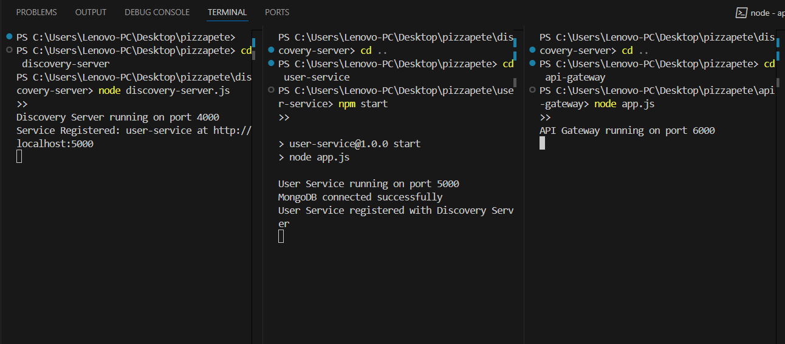

# 🍕 PizzaSteve - Microservices Pizza Ordering System

PizzaSteve is a full-stack pizza ordering application built with a microservices architecture. It provides a complete solution for online pizza ordering with user management, product catalog, cart functionality, inventory management, order processing, payment handling, and real-time notifications.

## ✨ Features

- 🔐 **User Authentication**: Secure JWT-based login and registration
- 🍕 **Product Catalog**: Browse pizza menu with categories and pricing
- 🛒 **Shopping Cart**: Add, remove, and manage cart items
- 📦 **Inventory Management**: Real-time stock tracking
- 📋 **Order Processing**: Complete order lifecycle management
- 💳 **Payment Integration**: Secure payment processing
- 📧 **Notifications**: Email and status updates
- 🌐 **Responsive Frontend**: Modern React-based user interface
- 🐳 **Docker Support**: One-command deployment with Docker Compose
- 🔄 **Service Discovery**: Automatic service registration and discovery
- 🌟 **API Gateway**: Centralized request routing and load balancing



## 📋 Table of Contents

- [🏗️ Architecture](#️-architecture)
- [🚀 Services](#-services)
- [💻 Technology Stack](#-technology-stack)
- [⚡ Quick Start with Docker](#-quick-start-with-docker)
- [🛠️ Manual Installation](#️-manual-installation)
- [🔧 Configuration](#-configuration)
- [📖 API Documentation](#-api-documentation)
- [🧪 Testing](#-testing)
- [🤝 Contributing](#-contributing)

## 🏗️ Architecture

PizzaSteve follows a microservices architecture pattern with the following components:

- **Frontend**: React application (port 3000)
- **API Gateway**: Central entry point routing requests to appropriate services (port 8080)
- **Discovery Server**: Service registry for microservices discovery (port 8761)
- **8 Core Services**: Each with its own MongoDB database

```
Frontend (React) → API Gateway → Discovery Server → Microservices
                                                  ↓
                                    [User, Product, Cart, Inventory,
                                     Order, Payment, Notification Services]
```

## 🚀 Services

| Service | Port | Purpose | Database Port |
|---------|------|---------|---------------|
| **Discovery Server** | 8761 | Service registry and discovery | - |
| **API Gateway** | 8080 | Request routing and load balancing | - |
| **User Service** | 5000 | User authentication and management | 27018 |
| **Product Service** | 5001 | Pizza menu and product catalog | 27019 |
| **Cart Service** | 5002 | Shopping cart management | 27020 |
| **Inventory Service** | 5003 | Stock and inventory tracking | 27021 |
| **Notification Service** | 5004 | Email and push notifications | 27022 |
| **Order Service** | 5005 | Order processing and management | 27023 |
| **Payment Service** | 5006 | Payment processing and transactions | 27024 |
| **Frontend** | 3000 | React web application | - |

### Service Descriptions

- **🔐 User Service**: Handles user registration, authentication (JWT), and profile management
- **🍕 Product Service**: Manages pizza menu, categories, pricing, and product details
- **🛒 Cart Service**: Manages shopping cart operations, add/remove items, cart persistence
- **📦 Inventory Service**: Tracks ingredient stock, availability, and inventory updates
- **📧 Notification Service**: Sends order confirmations, status updates, and promotional emails
- **📋 Order Service**: Processes orders, manages order status, and order history
- **💳 Payment Service**: Handles payment processing, transaction management, and billing
- **🌐 Frontend**: User-friendly React interface for browsing, ordering, and account management

## 💻 Technology Stack

### Backend
- **Runtime**: Node.js
- **Framework**: Express.js
- **Database**: MongoDB
- **Authentication**: JWT (JSON Web Tokens)
- **API**: RESTful APIs
- **Architecture**: Microservices

### Frontend
- **Framework**: React 18
- **Styling**: Bootstrap 5
- **HTTP Client**: Axios
- **Routing**: React Router DOM

### DevOps & Infrastructure
- **Containerization**: Docker & Docker Compose
- **Service Discovery**: Custom Node.js discovery server
- **API Gateway**: Express.js proxy server
- **CORS**: Enabled for cross-origin requests

## ⚡ Quick Start with Docker

The easiest way to run PizzaSteve is using Docker Compose, which will start all services and databases automatically.

### Prerequisites
- Docker (v20.0+)
- Docker Compose (v2.0+)

### Installation Steps

1. **Clone the repository**
   ```bash
   git clone https://github.com/RideneFiras/pizzasteve.git
   cd pizzasteve
   ```

2. **Start all services with Docker Compose**
   ```bash
   docker compose up -d
   ```

3. **Verify services are running**
   ```bash
   docker compose ps
   ```

4. **Access the application**
   - Frontend: http://localhost:3000
   - API Gateway: http://localhost:8080
   - Discovery Server: http://localhost:8761

### Docker Compose Services

The `docker-compose.yml` file defines:
- All 8 microservices with automatic service discovery
- 7 MongoDB databases (one per service that needs persistence)
- Proper networking and service dependencies
- Environment variables for Docker deployment

### Stopping the Application
```bash
docker compose down
```

### Viewing Logs
```bash
# View all service logs
docker compose logs

# View specific service logs
docker compose logs user-service
```

## 🛠️ Manual Installation

If you prefer to run the services manually or for development purposes:

### Prerequisites
- Node.js (v16.0+)
- MongoDB (v5.0+)
- npm (v8.0+)

### Installation Steps

1. **Clone the repository**
   ```bash
   git clone https://github.com/RideneFiras/pizzasteve.git
   cd pizzasteve
   ```

2. **Install main dependencies**
   ```bash
   npm install
   ```

3. **Set up MongoDB**
   ```bash
   # Start MongoDB service
   sudo systemctl start mongod  # Linux
   # or
   brew services start mongodb-community  # macOS
   ```

4. **Install and start each service**

   **Discovery Server:**
   ```bash
   cd discovery-server
   npm install
   npm start
   ```

   **User Service:**
   ```bash
   cd user-service
   npm install
   npm start  # or npm run dev for development
   ```

   **Product Service:**
   ```bash
   cd product-service
   npm install
   npm start
   ```

   **Continue for all services** (cart-service, inventory-service, notification-service, order-service, payement-service)

   **API Gateway:**
   ```bash
   cd api-gateway
   npm install
   npm start
   ```

   **Frontend:**
   ```bash
   cd frontend
   npm install
   npm start
   ```

### Development Mode

For development with hot-reload:
```bash
# For backend services that support it
npm run dev

# For frontend
cd frontend
npm start
```

## 🔧 Configuration

### Environment Variables

Each service can be configured using environment variables:

#### Common Variables
- `NODE_ENV`: development/production
- `PORT`: Service port (defaults as listed above)
- `MONGO_URI`: MongoDB connection string
- `JWT_SECRET`: JWT signing secret (for user service)

#### Docker Environment
- `DOCKER_ENV=true`: Enables Docker-specific configurations
- MongoDB connection strings are automatically configured for Docker containers

### Database Configuration

Each service connects to its own MongoDB database:
- User Service: `user-service-db` (port 27018)
- Product Service: `product-service-db` (port 27019)
- Cart Service: `cart-service-db` (port 27020)
- Inventory Service: `inventory-service-db` (port 27021)
- Notification Service: `notification-service-db` (port 27022)
- Order Service: `order-service-db` (port 27023)
- Payment Service: `payement-service-db` (port 27024)

### CORS Configuration

The API Gateway is configured to accept requests from:
- Frontend: `http://localhost:3000`
- Methods: GET, POST, PUT, DELETE
- Headers: Content-Type, Authorization

## 📖 API Documentation

### API Gateway Endpoints

All API requests should go through the API Gateway at `http://localhost:8080`

#### Format
```
http://localhost:8080/{service-name}/{endpoint}
```

#### Examples

**User Service:**
- `POST /user-service/register` - User registration
- `POST /user-service/login` - User login
- `GET /user-service/profile` - Get user profile

**Product Service:**
- `GET /product-service/products` - Get all products
- `GET /product-service/products/:id` - Get product by ID
- `POST /product-service/products` - Create new product (admin)

**Cart Service:**
- `GET /cart-service/cart/:userId` - Get user cart
- `POST /cart-service/cart/add` - Add item to cart
- `DELETE /cart-service/cart/remove/:itemId` - Remove item from cart

**Order Service:**
- `POST /order-service/orders` - Create new order
- `GET /order-service/orders/:userId` - Get user orders
- `PUT /order-service/orders/:orderId/status` - Update order status

### Authentication

Most endpoints require JWT authentication:
```javascript
headers: {
  'Authorization': `Bearer ${token}`,
  'Content-Type': 'application/json'
}
```

### Service Health Checks

Each service provides a health check endpoint:
- `GET /{service-name}/test` - Returns service status

## 🧪 Testing

### Running Tests

Currently, the project has basic test setup:
```bash
# Main project
npm test

# Individual services
cd user-service
npm test
```

### API Testing

You can test the APIs using:
- **Postman**: Import the service endpoints
- **curl**: Command line testing
- **Frontend**: Use the React application

#### Example API Test
```bash
# Test user registration
curl -X POST http://localhost:8080/user-service/register \
  -H "Content-Type: application/json" \
  -d '{"username": "testuser", "email": "test@example.com", "password": "password123"}'
```

## 🤝 Contributing

1. Fork the repository
2. Create your feature branch (`git checkout -b feature/AmazingFeature`)
3. Commit your changes (`git commit -m 'Add some AmazingFeature'`)
4. Push to the branch (`git push origin feature/AmazingFeature`)
5. Open a Pull Request

### Development Guidelines

- Follow the existing code style
- Add tests for new features
- Update documentation as needed
- Ensure all services work together properly

### Project Structure

```
pizzasteve/
├── api-gateway/           # API Gateway service
├── cart-service/          # Shopping cart microservice
├── discovery-server/      # Service registry
├── frontend/             # React web application
├── inventory-service/    # Stock management service
├── notification-service/ # Email/notification service
├── order-service/        # Order processing service
├── payement-service/     # Payment processing service
├── product-service/      # Product catalog service
├── user-service/         # User authentication service
├── Auth-Middleware/      # Shared authentication middleware
├── docker-compose.yml    # Docker services configuration
└── README.md            # Project documentation
```

## 📝 License

This project is licensed under the ISC License.

## 🆘 Support

## 🆘 Support

If you encounter any issues:

1. **Check that all services are running on their expected ports**
   ```bash
   docker compose ps
   # Should show all services as "running"
   ```

2. **Verify MongoDB connections are working**
   ```bash
   docker compose logs user-service-db
   # Should show successful MongoDB startup
   ```

3. **Check service discovery is working**
   ```bash
   curl http://localhost:8761/services
   # Should return JSON array of registered services
   ```

4. **Review service logs for error messages**
   ```bash
   docker compose logs api-gateway
   docker compose logs user-service
   # Check for connection errors or startup issues
   ```

5. **Ensure no port conflicts**
   ```bash
   netstat -tlnp | grep :3000
   # Should be empty if port is available
   ```

### Common Issues

- **Port already in use**: Stop other services using the same ports
- **MongoDB connection failed**: Ensure MongoDB containers are running
- **Services not registering**: Check discovery server is accessible
- **CORS errors**: Verify API Gateway CORS configuration matches frontend URL

### Manual Service Testing

Test individual services directly:
```bash
# Test discovery server
curl http://localhost:8761/services

# Test user service health
curl http://localhost:5000/test

# Test API gateway routing
curl http://localhost:8080/user-service/test
```

For additional support, please open an issue in the GitHub repository.

---

**Happy Pizza Ordering! 🍕**